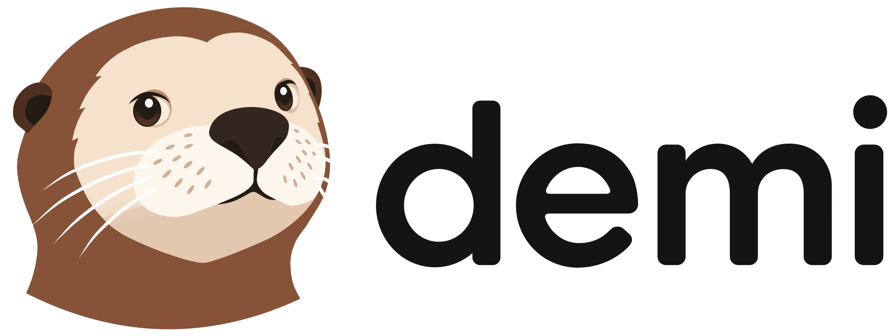

<p align="center">
  <picture>
    <source media="(prefers-color-scheme: dark)" srcset="docs/assets/brand/lockup-dark.svg">
    
  </picture>
</p>

<p align="center">
  <strong>채팅, 업무, 코딩을 위한 셀프 호스팅 AI 에이전트.<br>
  어느 브라우저에서나 사용하고, 클라우드와 내 모든 컴퓨터에서 작업을 맡기세요.</strong>
</p>

<p align="center">
  <a href="#라이선스"></a>
  <a href="https://github.com/wspl/demi/releases/latest"></a>
  <a href="https://github.com/wspl/demi/actions/workflows/ci.yml"></a>
</p>

<p align="center">
  <a href="README.md">English</a> · <a href="README.zh-CN.md">简体中文</a> · <a href="README.zh-TW.md">繁體中文</a> · <a href="README.ja.md">日本語</a> · <b>한국어</b>
</p>

<!-- Screenshot -->

Demi는 어느 브라우저에서나 사용할 수 있는 셀프 호스팅 AI 에이전트입니다. 간단한 질문부터 맡기고 싶은 일까지, 자료 조사, 웹사이트 조작, 파일 작업, 코드 작성을 모두 하나의 대화에서 처리합니다.

모든 대화는 내 서버 한곳에 저장되어 어느 기기에서나 같은 대화를 볼 수 있습니다. 컴퓨터는 작업을 실행할 뿐입니다. 에이전트는 클라우드 샌드박스나 내가 가진 여러 컴퓨터에서 작업하며, 탭을 닫아도 작업은 계속됩니다.

<p align="center">
  
</p>

> [!NOTE]
> Demi는 초기 개발 단계입니다. 릴리스 사이에 호환되지 않는 변경이 있을 수 있습니다.

## 빠른 시작

필요한 것:

- root 권한이 있는 Linux 서버. 운영체제는 다음 중 하나여야 합니다([지원 배포판](docs/delivery/installation.md#distributions)):
  - Ubuntu 22.04 이상, Debian 12 이상
  - Fedora, RHEL 10, Rocky Linux, AlmaLinux
  - Arch Linux
- 도메인 이름과, 서버 앞단에서 제공하는 HTTPS([HTTPS 설정 방법](docs/delivery/installation.md#https)).

서버에서 다음 명령을 실행합니다:

```sh
curl -fsSL https://demi.sh/install.sh | sudo bash
```

설치 프로그램이 몇 가지를 물어본 뒤 Demi를 설정합니다. 설치가 끝나면:

1. 바로 도메인을 열고 관리자 계정을 만듭니다.
2. **Settings › Providers**에서 구독 계정으로 로그인하거나 API 키를 추가합니다.
3. 대화를 시작합니다. 대화는 클라우드 샌드박스에서 실행됩니다.
4. 내 컴퓨터에서 작업하게 하려면 대화의 호스트 메뉴에서 **Add Device**를 선택하고, 표시된 명령을 그 컴퓨터에서 실행합니다.

질문 없이 설치하는 방법을 포함한 모든 옵션은 [설치 가이드](docs/delivery/installation.md)를, 새 릴리스로 옮기는 방법은 [업그레이드](docs/delivery/upgrades.md)를 참고하세요.

## 주요 기능

Demi의 기능은 네 가지 그룹으로 나뉩니다.

### 채팅, 업무, 코딩

- **하나의 대화로 모든 일을**: 간단한 질문도, 여러 단계의 작업도 같은 곳에서 맡깁니다. 모드를 바꿀 필요가 없습니다.
- **코딩**: 저장소를 수정하고 빌드와 테스트를 실행하며, 모든 변경을 diff로 확인합니다.
- **리서치**: 웹을 검색하고 웹 페이지, PDF, 각종 문서를 읽습니다.
- **실제 브라우저**: Demi가 Chrome을 조작해 로그인하고, 양식을 작성하고, 파일을 다운로드합니다. 사이드 패널에서 지켜보다가 언제든 직접 이어받을 수 있습니다.
- **파일과 데이터**: 문서, 스프레드시트, 이미지를 다루고 결과를 첨부 파일로 받아 봅니다.
- **공유**: 대화 전체나 답변 하나를 읽기 전용 링크로 공유합니다.

### 어디서든, 어느 컴퓨터에서든

- **어느 브라우저에서나**: 데스크톱, 태블릿, 휴대폰에서 설치 없이 사용합니다.
- **항상 실행**: 탭을 닫아도 작업은 서버에서 계속됩니다.
- **모든 대화를 한곳에**: 대화는 서버에 저장되며, 에이전트가 작업한 컴퓨터마다 흩어지지 않습니다. 노트북에서 시작한 대화를 휴대폰에서 실시간으로 이어 갑니다.
- **QR 코드와 패스키 로그인**: 코드를 스캔해 휴대폰에서 로그인하거나 Touch ID, Face ID, Windows Hello를 사용합니다.
- **전용 클라우드 샌드박스**: 사용자마다 내 서버에 전용 Linux 샌드박스가 주어집니다. gVisor 안에서 실행되며, 서버의 서비스나 사설 네트워크에 접근할 수 없고 다른 사용자의 샌드박스도 볼 수 없습니다.
- **내 컴퓨터 연결**: macOS, Windows, Linux 컴퓨터를 명령 하나로 연결합니다. 포트를 열 필요가 없습니다.
- **여러 컴퓨터에서 하는 작업**: 하나의 대화에서 여러 컴퓨터를 사용합니다. 예를 들어 Mac에서 빌드하고 Windows에서 테스트할 수 있습니다.
- **작업 중 컴퓨터 전환**: 처음부터 다시 시작하지 않고 대화를 클라우드와 내 컴퓨터 사이에서 옮깁니다.

### 에이전트

- **멀티 에이전트**: Demi는 큰 작업을 병렬로 일하는 에이전트 팀에 나누어 맡기고, 그 결과를 하나로 정리합니다.
- **에이전트 프로필**: 리서처나 리뷰어 같은 전문 에이전트를 정의하고, 각각 모델, 추론 수준, 지침, 명령을 설정합니다.
- **워크플로**: 한 종류의 작업을 위해 에이전트 프로필과 지침을 하나로 묶습니다. 프로젝트의 `.demi/workflows/`에 두고 메시지 입력창에서 선택하며, 저장소를 통해 팀과 공유합니다.
- **스킬**: 스킬을 설치해 Demi에게 새로운 작업을 가르칩니다.
- **안전한 자격 증명 관리**: API 키와 비밀번호는 안전한 양식으로 요청되며, 대화에 나타나지 않습니다.

### 모델과 팀

- **기존 구독 사용**: Claude, ChatGPT, Grok Build 계정으로 로그인합니다. 구독마다 여러 계정을 추가할 수 있고, 사용 한도에 도달하면 Demi가 계정을 바꿔 가며 사용합니다.
- **모든 API**: Anthropic, OpenAI, Gemini 및 호환되는 모든 엔드포인트를 지원합니다.
- **언제든 모델 전환**: 작업 도중에도 모델이나 추론 수준을 바꿀 수 있습니다.
- **다중 사용자**: 사용자마다 자신의 샌드박스, 기기, 대화를 가지며, 관리자의 구독이나 자신의 구독을 사용합니다.
- **관리 도구**: 사용자를 추가하고, 역할을 관리하고, 비밀번호를 재설정하고, 휴대폰 로그인 코드를 보냅니다.
- **명령 하나로 설치와 업그레이드**: 명령 하나로 서버를 설정하고, 또 하나로 업그레이드합니다.

## 셸 위에 만든 에이전트

Demi는 앱이자 에이전트 그 자체입니다.

Claude Code나 Codex를 감싸지 않고, 자체 런타임이 모든 모델을 구동합니다. Claude나 ChatGPT 구독은 모델을 사용하는 데에만 쓰입니다.

대부분의 에이전트는 모델에 긴 도구 목록을 주지만, Demi는 셸 하나만 줍니다. 브라우저, 다른 컴퓨터, 하위 에이전트 등 나머지는 모두 그 셸 안의 `demi` 명령입니다:

```sh
demi browser open http://localhost:5173 && demi browser screenshot t1 | demi file view
demi host shell --host windows 'cargo test'
demi agent spawn --profile research --description "Compare pricing pages" < brief.md
```

이 설계에는 다음과 같은 장점이 있습니다:

- **조합 가능**: 명령을 파이프와 `&&`로 이어 붙일 수 있어, 보통 여러 번의 도구 호출이 필요한 일을 한 번에 처리합니다.
- **간결한 프롬프트**: 모델에는 명령 그룹마다 한 줄만 보이고, 필요할 때 `--help`를 읽습니다. 기능이 늘어나도 요청이 비대해지지 않습니다.
- **어디서나 동일**: 모든 컴퓨터가 Rust로 작성된 같은 bash 호환 셸과 GNU 도구([brush](https://github.com/reubeno/brush), [uutils](https://github.com/uutils/coreutils), ripgrep, [jaq](https://github.com/01mf02/jaq))를 실행합니다. 클라우드에서 동작하는 스크립트는 macOS와 Windows에서도 그대로 동작합니다.
- **모든 모델에 동일**: 어느 제공자의 모델이든 같은 도구 하나를 보므로, 모델을 바꿔도 에이전트가 할 수 있는 일은 달라지지 않습니다.
- **오래 걸리는 작업에 적합**: 명령은 백그라운드에서 계속 실행되고 끝나면 보고하므로, 개발 서버나 테스트 스위트가 대화를 막지 않습니다.

> [!NOTE]
> **계획**: Demi 에이전트 런타임을 독립된 TypeScript 라이브러리로 제공해, Demi 앱 없이도 그 위에 자신만의 에이전트를 만들 수 있게 할 예정입니다.

## 아키텍처

다음 그림은 각 부분이 어떻게 연결되는지 보여 줍니다:

```text
  Browsers (computer, phone, tablet)
        │  HTTPS + WebSocket
        ▼
  ┌──────────────────────────┐   HTTPS   ┌────────────────────┐
  │ Demi server              │──────────▶│ Model providers    │
  │ users, conversations,    │           └────────────────────┘
  │ agents                   │
  └──────────────────────────┘
        ▲                ▲
        │ WebSocket      │ WebSocket
  ┌─────┴──────────┐  ┌──┴───────────────────────────┐
  │ Runner in your │  │ Runners on your computers    │
  │ cloud sandbox  │  │ and servers (macOS, Windows, │
  │ (gVisor)       │  │ Linux)                       │
  └────────────────┘  └──────────────────────────────┘
```

이 구조에는 다음과 같은 특징이 있습니다:

- **에이전트는 서버에서, 작업은 러너가**: 대화, 에이전트, 설정은 서버에 있습니다. 각 컴퓨터의 작은 러너는 파일, 명령, 브라우저만 다룹니다. 러너가 서버로 먼저 연결하므로 NAT나 방화벽 뒤에서도 동작합니다.
- **어디서나 같은 러너**: 클라우드 샌드박스와 내 컴퓨터가 같은 러너를 실행하므로, 모든 기능을 어느 컴퓨터에서나 쓸 수 있습니다.
- **대역폭 절약**: 큰 출력과 파일은 그것을 만든 컴퓨터에 남습니다. 브라우저는 열 때에만 불러옵니다.
- **네이티브**: 서버, 러너, 에이전트의 도구는 Rust로 작성되었습니다. 웹 앱은 Vue와 TypeScript로 만들었습니다.

[설계 문서](docs/README.md)는 [개요](docs/overview.md)부터 읽어 보세요(영문).

## 비교

Pi, DeepSeek Harness, OpenHands, opencode, Orca, herdr, T3 Code와 Demi의 기능별 비교는 [Demi 비교](docs/comparison.ko.md)를 참고하세요.

## 문서

- [설계 문서](docs/README.md): Demi의 각 부분이 동작하는 방식
- [기여하기](CONTRIBUTING.md): 개발 환경, 검사, 모델 제공자 추가 방법
- [보안](SECURITY.md): 취약점 신고 방법과 데이터 저장 위치

이 문서들은 영문으로 작성되어 있습니다.

## 라이선스

Demi의 대부분은 [Apache License 2.0](LICENSE)으로 공개되며, 어떤 용도로든 사용할 수 있습니다. 여기에는 다음이 포함됩니다:

- 에이전트 런타임
- 모델 제공자
- 내 컴퓨터에 설치하는 러너
- 명령
- 플러그인과 그 SDK
- UI 컴포넌트 라이브러리와 그 갤러리
- 프로토콜
- 문서

서버와 웹 앱(`crates/backend*`, `crates/server`, `crates/machine-manager`, `packages/web`)은 [Demi License](LICENSE-DEMI)로 공개됩니다. 이는 Apache License 2.0에 다음 조건을 더한 것입니다:

- **무료 사용**: 회사에서 자신의 팀을 위해 쓰는 것을 포함해 사용, 수정, 실행할 수 있습니다.
- **지원 제공 가능**: 다른 사람이 직접 운영하는 Demi의 배포, 통합, 지원을 유료로 제공할 수 있습니다.
- **서비스로 재판매 금지**: 유료 호스팅 서비스나 멀티테넌트 서비스로, 또는 사실상 Demi인 제품으로 다른 사람에게 제공할 수 없습니다.
- **브랜드 유지**: 웹 앱의 Demi 이름, 로고, 저작권 표시를 제거하거나 변경하지 마세요.

다른 용도는 [support@demi.sh](mailto:support@demi.sh)로 문의하세요.
