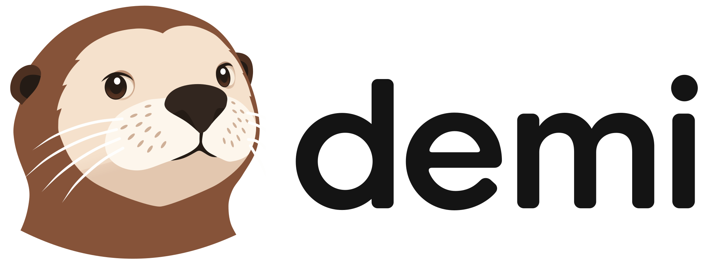
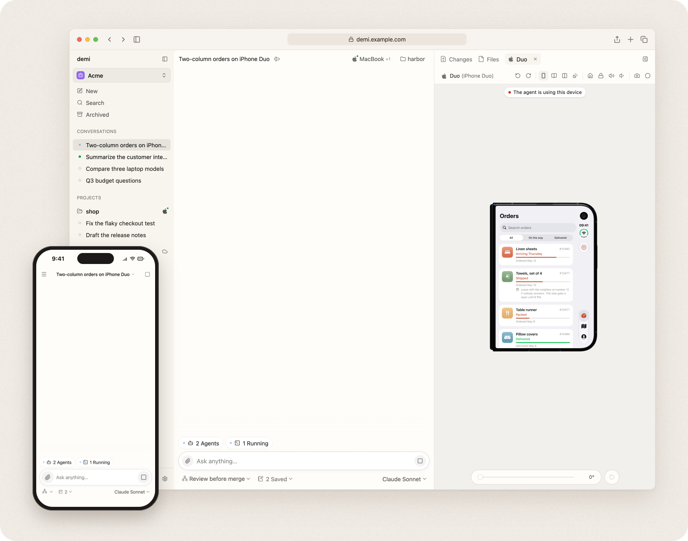
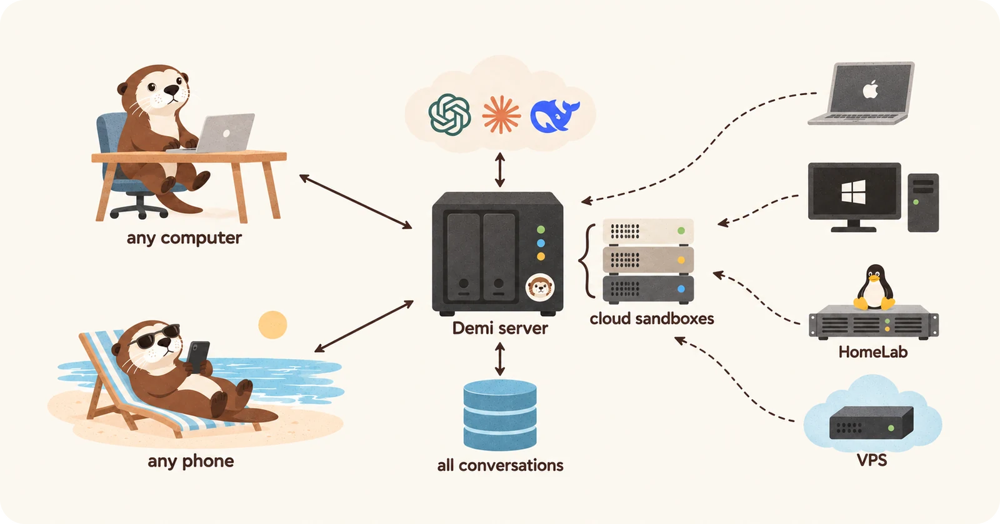

<p align="center">
  <picture>
    <source media="(prefers-color-scheme: dark)" srcset="docs/assets/brand/lockup-dark.svg">
    
  </picture>
</p>

<p align="center">
  <strong>Seu agente, em todas as suas máquinas.<br>
  Um agente de IA na web que você hospeda no seu próprio servidor.</strong>
</p>

<p align="center">
  <a href="#licença"></a>
  <a href="https://github.com/wspl/demi/releases/latest"></a>
  <a href="https://github.com/wspl/demi/actions/workflows/ci.yml"></a>
</p>

<p align="center">
  <a href="README.md">English</a> · <a href="README.de.md">Deutsch</a> · <a href="README.es.md">Español</a> · <a href="README.fr.md">Français</a> · <b>Português</b> · <a href="README.zh-CN.md">简体中文</a> · <a href="README.zh-TW.md">繁體中文</a> · <a href="README.ja.md">日本語</a> · <a href="README.ko.md">한국어</a>
</p>

<p align="center">
  
</p>

O Demi é um agente de IA na web que você hospeda no seu próprio servidor. Abra-o
em qualquer navegador. Faça uma pergunta ou passe um trabalho: pesquisa, uso de
sites, trabalho com arquivos, escrita de código, tudo na mesma conversa.

Cada conversa fica no seu servidor, em um só lugar para todos os seus
dispositivos. Seus computadores só executam o trabalho: o agente trabalha em uma
sandbox na nuvem ou nas suas próprias máquinas, e as tarefas continuam rodando
quando você fecha a aba.

<p align="center">
  
</p>

> [!NOTE]
> O Demi está no início do desenvolvimento. Espere mudanças incompatíveis entre
> versões.

## Início rápido

Você precisa do seguinte:

- Um servidor Linux em que você tenha acesso root, com um destes sistemas
  ([distribuições compatíveis](docs/delivery/installation.md#distributions)):
  - Ubuntu 22.04 ou posterior, Debian 12 ou posterior
  - Fedora, RHEL 10, Rocky Linux, AlmaLinux
  - Arch Linux
- Um nome de domínio servido por HTTPS na frente do servidor ([configurar o
  HTTPS](docs/delivery/installation.md#https)).

Execute o comando no servidor. Ele instala o Beta, as versões que o Demi
publica; `--canary` instala o Canary, que recebe cada build primeiro:

```sh
# Beta
curl -fsSL https://demi.sh/install.sh | sudo bash
# Canary
curl -fsSL https://demi.sh/install.sh | sudo bash -s -- --canary
```

Ou dê este prompt a um agente de programação como o Claude Code ou o Codex:

```text
Instale o Demi no meu servidor seguindo https://raw.githubusercontent.com/wspl/demi/main/docs/delivery/install-with-an-agent.md
```

O instalador faz algumas perguntas e configura o Demi. Quando terminar:

1. Abra seu domínio logo em seguida e crie a conta de administrador.
2. Vá em **Configurações › Provedores** e entre com uma assinatura ou adicione
   uma chave de API.
3. Inicie uma conversa. Ela é executada na sua sandbox na nuvem.
4. Para trabalhar no seu próprio computador, escolha **Adicionar dispositivo**
   no menu de host da conversa e execute nesse computador o comando que aparece.

Veja o [guia de instalação](docs/delivery/installation.md) para todas as opções,
incluindo a instalação sem perguntas, e as
[atualizações](docs/delivery/upgrades.md) para mudar para uma nova versão.

## Principais recursos

Os recursos do Demi se dividem em quatro grupos.

### Conversar, trabalhar e programar

- **Uma conversa para tudo**: Faça uma pergunta rápida ou passe um trabalho de
  várias etapas no mesmo lugar. Sem modos para alternar.
- **Programação**: Edite repositórios, rode builds e testes e revise cada
  alteração como um diff.
- **Pesquisa**: Busque na web e leia páginas, PDFs e documentos.
- **Navegador de verdade**: O Demi controla o Chrome para entrar em sites,
  preencher formulários e baixar arquivos. Acompanhe no painel lateral e assuma
  o controle quando quiser.
- **Apps de celular**: O Demi controla simuladores de iOS e emuladores de
  Android para instalar, executar e testar um app, e grava a tela. Acompanhe no
  painel lateral e assuma o controle quando quiser.
- **Arquivos e dados**: Trabalhe com documentos, planilhas e imagens e receba os
  resultados como anexos.
- **Imagens, vídeo e áudio**: Crie e edite imagens e gere vídeos, fala, música e
  efeitos sonoros com os provedores de modelos que você adicionar.
- **Compartilhar**: Compartilhe uma conversa, ou uma única resposta, como um
  link somente leitura.
- **Comentários e perguntas**: Selecione palavras em uma resposta para comentar
  ou perguntar sobre elas, sem interromper a tarefa.
- **Busca**: Encontre qualquer mensagem em todas as conversas, ou naquela que
  você está lendo.

### Em qualquer lugar, em qualquer máquina

- **Funciona em qualquer navegador**: Computador, tablet ou celular, sem
  instalar nada. Adicione-o à Tela de Início, e ele se adapta a celulares,
  tablets e dobráveis.
- **Nove idiomas**: Inglês, alemão, espanhol, francês, português, chinês
  simplificado, chinês tradicional, japonês e coreano.
- **Sempre ativo**: As tarefas continuam rodando no servidor depois que você
  fecha a aba.
- **Notificações**: Receba avisos no celular e nos computadores quando uma
  tarefa terminar ou precisar de você, mesmo com o Demi fechado.
- **Um só lugar para todas as conversas**: O servidor guarda as conversas em vez
  de espalhá-las pelas máquinas em que o agente trabalhou. Comece no notebook e
  continue no celular, ao vivo. Troque de provedor de IA e mantenha seu
  histórico.
- **Login com código QR e chave-senha**: Escaneie um código para entrar no
  celular, ou use Touch ID, Face ID ou Windows Hello.
- **Sandbox privada na nuvem**: Cada usuário tem a própria sandbox Linux no seu
  servidor. Ela roda sob o gVisor, não alcança os serviços do seu servidor nem
  sua rede privada e não vê as sandboxes de outros usuários.
- **Use seus próprios computadores**: Conecte máquinas macOS, Windows e Linux
  com um único comando. Não é preciso abrir portas.
- **Tarefas em várias máquinas**: Use várias máquinas em uma conversa, por
  exemplo para compilar em um Mac e testar no Windows.
- **Troque de máquina no meio da tarefa**: Mova uma conversa entre a nuvem e
  seus computadores sem recomeçar.
- **Arquivos em cada máquina**: Navegue pelos arquivos da sandbox e de cada um
  dos seus computadores, visualize imagens, vídeos, áudio, PDFs e Markdown,
  envie e baixe arquivos e busque nomes de arquivo e texto.
- **Encaminhamento de portas**: Acesse uma porta de uma máquina a partir de
  outra.

### Agente

- **Vários agentes**: O Demi divide uma tarefa grande entre uma equipe de
  agentes que trabalham em paralelo e depois combina os resultados.
- **Perfis de agente**: Defina agentes especializados, como um de pesquisa ou um
  de revisão, cada um com o próprio modelo, nível de raciocínio, instruções e
  comandos.
- **Fluxos de trabalho**: Agrupe um conjunto de perfis de agente com instruções
  para um tipo de trabalho. Guarde os fluxos de trabalho na pasta
  `.demi/workflows/` de um projeto, escolha um no campo de mensagem e
  compartilhe-os com sua equipe pelo repositório.
- **Agendamentos**: Ative uma conversa uma vez, em um ciclo repetido, em
  intervalos, com cron, quando a saída de um comando mudar ou quando uma URL for
  chamada.
- **Conversas trabalham juntas**: Uma conversa envia mensagens a outra e lê os
  históricos de outras conversas.
- **Habilidades**: Instale habilidades para ensinar novas tarefas ao Demi.
- **Credenciais seguras**: O Demi pede chaves de API e senhas por meio de um
  formulário seguro, e elas nunca aparecem na conversa.

### Modelos e equipes

- **Use suas assinaturas**: Entre com contas do Claude, do ChatGPT ou do Grok
  Build. Adicione várias contas por assinatura, e o Demi alterna entre elas
  conforme os limites de uso se esgotam.
- **Planos de programação**: Use a chave de um plano de programação, como Kimi,
  GLM ou MiniMax.
- **Chaves de API**: Anthropic, OpenAI, Gemini ou qualquer endpoint compatível.
- **Modelos locais**: Deixe seu servidor usar um modelo que roda no seu próprio
  computador, como o Ollama, por meio do encaminhamento de portas.
- **Troque de modelo quando quiser**: Mude o modelo ou o nível de raciocínio,
  até no meio de uma tarefa.
- **Uso e custo**: Veja quanto dos limites de cada assinatura foi usado e quando
  eles são redefinidos, e quanto o trabalho custou na última hora, no último dia
  ou no total.
- **Vários usuários**: Cada usuário tem a própria sandbox, os próprios
  dispositivos e as próprias conversas, com as assinaturas do administrador ou
  as dele.
- **Ferramentas de administração**: Adicione usuários, gerencie funções,
  redefina senhas e envie códigos de login para o celular.
- **Instalação e atualizações em uma linha**: Configure um servidor com um
  comando e atualize-o com outro.

## Um agente construído sobre um shell

O Demi é ao mesmo tempo o app e o agente.

Ele não é um invólucro do Claude Code ou do Codex. O próprio runtime dele
controla todos os modelos, e uma assinatura do Claude ou do ChatGPT fornece
apenas o modelo.

A maioria dos agentes dá ao modelo uma longa lista de ferramentas. O Demi dá uma
só: um shell. Todo o resto, do navegador a outras máquinas e aos subagentes, é
um comando `demi` dentro dele:

```sh
T=$(demi browser tab new) && demi browser open $T http://localhost:5173 && demi browser screenshot $T | demi file view
demi host shell --host windows 'cargo test'
demi agent spawn --profile research --description "Compare pricing pages" < brief.md
```

O design tem estas vantagens:

- **Combinável**: Os comandos se encadeiam com pipes e `&&`, então o agente faz
  em um passo o que normalmente exige várias chamadas de ferramentas.
- **Prompts enxutos**: O modelo vê uma linha por grupo de comandos e lê `--help`
  quando precisa de mais. Novos recursos não incham cada solicitação.
- **O mesmo shell em todo lugar**: Cada máquina executa o mesmo shell compatível
  com bash, escrito em Rust ([brush](https://github.com/reubeno/brush)), então
  um script que funciona na nuvem também funciona no macOS e no Windows. As
  ferramentas que alteram arquivos são as do GNU em todas as máquinas
  ([uutils](https://github.com/uutils/coreutils)), então as alterações delas são
  registradas; qualquer outro programa, como `tar` ou `python`, é o do sistema,
  e as alterações dele não são registradas. No Windows, os demais utilitários
  são os do Git for Windows, que a configuração do Demi instala quando ele
  falta.
- **Igual para todos os modelos**: Todos os provedores veem a mesma ferramenta
  única, então trocar de modelo não muda o que o agente consegue fazer.
- **Feito para trabalhos longos**: Os comandos continuam rodando em segundo
  plano e avisam quando terminam, então servidores de desenvolvimento e suítes
  de testes nunca travam a conversa.

> [!NOTE]
> **Planejado**: uma OpenAPI para o servidor do Demi, para que seus próprios
> programas usem as conversas, os agentes e as sandboxes na nuvem dele para os
> agentes de que você precisa.

## Arquitetura

O diagrama a seguir mostra como as partes se conectam:

```text
  Browsers (computer, phone, tablet)
        │  HTTPS + WebSocket
        ▼
  ┌──────────────────────────┐   HTTPS   ┌────────────────────┐
  │ Demi server              │──────────▶│ Model providers    │
  │ users, conversations,    │           └────────────────────┘
  │ agents                   │
  └──────────────────────────┘
        ▲                ▲
        │ WebSocket      │ WebSocket
  ┌─────┴──────────┐  ┌──┴───────────────────────────┐
  │ Runner in your │  │ Runners on your computers    │
  │ cloud sandbox  │  │ and servers (macOS, Windows, │
  │ (gVisor)       │  │ Linux)                       │
  └────────────────┘  └──────────────────────────────┘
```

O design tem estas propriedades:

- **O servidor executa o agente, os runners fazem o trabalho**: Conversas,
  agentes e configurações ficam no servidor. Um pequeno runner em cada máquina
  cuida só de arquivos, comandos e do navegador. Ele se conecta de dentro para
  fora com o servidor, então funciona atrás de NAT e firewalls.
- **Um só runner em todo lugar**: A sandbox na nuvem e seus computadores
  executam o mesmo runner, então todos os recursos funcionam em todas as
  máquinas.
- **Pouca banda**: Saídas e arquivos grandes ficam na máquina que os gerou. O
  navegador só os carrega quando você os abre.
- **Nativo**: O servidor, o runner e as ferramentas do agente são escritos em
  Rust. O app web é feito com Vue e TypeScript.

Leia a [documentação de design](docs/README.md), começando pela [visão
geral](docs/overview.md) (em inglês).

## Comparação

Como o Demi se diferencia do OpenHands, Orca, T3 Code, DeepSeek Harness,
opencode, Pi e herdr, recurso por recurso:
[Demi comparado](docs/comparison.pt-BR.md).

## Documentação

- [Documentação de design](docs/README.md): como cada parte do Demi funciona
- [Contribuir](CONTRIBUTING.md): ambiente de desenvolvimento, verificações e
  como adicionar um provedor
- [Segurança](SECURITY.md): como relatar vulnerabilidades e onde os dados são
  armazenados

Esses documentos estão em inglês.

## Licença

A maior parte do Demi é publicada sob a [Apache License 2.0](LICENSE). Use estas
partes para qualquer finalidade:

- O runtime do agente.
- Os provedores de modelos e a biblioteca que os configura a partir da sua
  configuração.
- O runner que você instala nas suas máquinas e a biblioteca que o controla.
- Os comandos.
- Os plugins, o SDK deles e o host que os executa.
- A biblioteca de componentes de interface e a galeria dela.
- Os protocolos.
- A documentação.

O servidor e o app web (`crates/backend*`, `crates/server`,
`crates/machine-manager` e `packages/web`) são publicados sob a [Demi
License](LICENSE-DEMI), que é a Apache License 2.0 com condições adicionais:

- **Uso livre**: Use, modifique e execute, inclusive na sua empresa para a sua
  própria equipe.
- **Suporte livre**: Cobre por implantar, integrar ou dar suporte a instalações
  do Demi que outras pessoas executam por conta própria.
- **Sem revenda como serviço**: Não os ofereça a terceiros mediante pagamento
  como serviço hospedado ou multilocatário, nem como um produto que seja
  essencialmente o Demi.
- **Mantenha a marca**: Não remova nem altere o nome, o logotipo ou os avisos de
  direitos autorais do Demi no app web.

Para outros usos, entre em contato pelo
[support@demi.sh](mailto:support@demi.sh).
