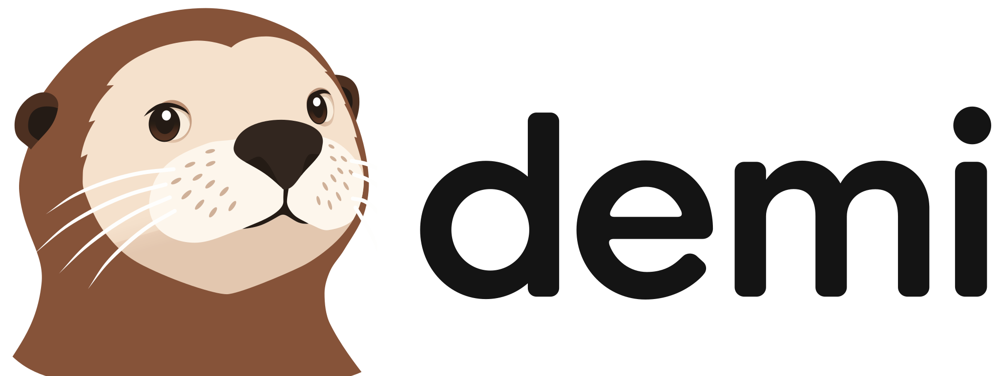
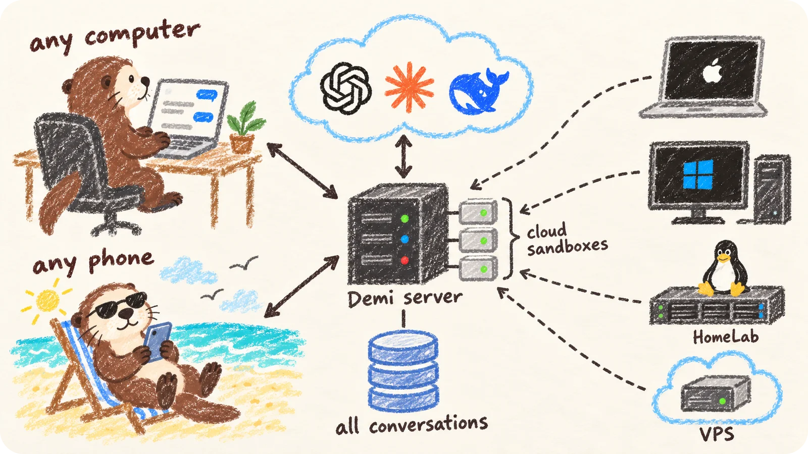

<p align="center">
  <picture>
    <source media="(prefers-color-scheme: dark)" srcset="brand/lockup-dark.svg">
    
  </picture>
</p>

<p align="center">
  <strong>自架的 AI 智慧體，聊天、辦事、寫程式都能勝任。<br>
  在任何瀏覽器中使用，在雲端和你所有的電腦上工作。</strong>
</p>

<p align="center">
  <a href="#授權條款"></a>
  <a href="https://github.com/wspl/demi/releases/latest"></a>
  <a href="https://github.com/wspl/demi/actions/workflows/ci.yml"></a>
</p>

<p align="center">
  <a href="README.md">English</a> · <a href="README.zh-CN.md">简体中文</a> · <b>繁體中文</b> · <a href="README.ja.md">日本語</a> · <a href="README.ko.md">한국어</a>
</p>

<!-- Screenshot -->

Demi 是一個自架的 AI 智慧體，在任何瀏覽器中都能使用。隨口問個問題，或把一整件事交給它：查資料、操作網站、處理檔案、寫程式，都在同一個對話裡完成。

所有對話都集中儲存在你的伺服器上，每台裝置看到的都是同一份。你的電腦只負責執行：智慧體在雲端沙箱或你自己的多台機器上工作，關掉網頁後任務照常進行。

<p align="center">
  
</p>

> [!NOTE]
> Demi 目前處於早期開發階段，版本之間可能有不相容的變更。

## 快速開始

你需要：

- 一台有 root 權限的 Linux 伺服器，系統為以下之一（[詳細說明](docs/delivery/installation.md#distributions)）：
  - Ubuntu 22.04 以上、Debian 12 以上
  - Fedora、RHEL 10、Rocky Linux、AlmaLinux
  - Arch Linux
- 一個網域名稱，並在伺服器前端提供 HTTPS（[設定方式](docs/delivery/installation.md#https)）。

然後在伺服器上執行：

```sh
curl -fsSL https://demi.sh/install.sh | sudo bash
```

安裝程式會問幾個問題，然後完成安裝。接下來：

1. 立即開啟你的網域，建立管理員帳號。
2. 前往 **Settings › Providers**，用訂閱帳號登入或新增 API 金鑰。
3. 開始一個對話，它會在你的雲端沙箱中執行。
4. 如需在自己的電腦上工作，在對話的主機選單中選擇 **Add Device**，然後在那台電腦上執行顯示的指令。

所有選項（包括免互動安裝）請參閱[安裝指南](docs/delivery/installation.md)，升級方式請參閱[升級說明](docs/delivery/upgrades.md)。

## 主要特色

### 聊天、辦事、寫程式

- **一個對話搞定所有事**：簡單問題直接回答，複雜任務也在同一個對話裡完成，不必切換模式。
- **寫程式**：修改程式碼儲存庫，執行建置和測試，每處變更都能以 diff 檢視。
- **研究**：搜尋網路，閱讀網頁、PDF 和各類文件。
- **真實瀏覽器**：Demi 會操作 Chrome 完成登入、填寫表單、下載檔案。你可以在側邊面板中即時觀看，隨時接手。
- **檔案與資料**：處理文件、試算表和圖片，結果以附件形式傳回給你。
- **分享**：把整個對話或單則回答分享為唯讀連結。

### 隨時隨地，任何機器

- **瀏覽器即可使用**：電腦、平板、手機皆可使用，不需安裝任何軟體。
- **背景執行**：關掉網頁後，任務仍在伺服器上繼續執行。
- **對話集中管理**：對話統一儲存在伺服器上，不會散落在智慧體工作過的各台機器裡。在筆電上開始，在手機上繼續，即時同步。
- **掃碼與通行密鑰登入**：用手機掃描代碼即可登入，也支援 Touch ID、Face ID 和 Windows Hello。
- **專屬雲端沙箱**：每位使用者在你的伺服器上都有獨立的 Linux 沙箱。它在 gVisor 中執行，連不到伺服器上的服務和你的內部網路，也看不到其他使用者的沙箱。
- **連接你自己的電腦**：一行指令即可連接 macOS、Windows 和 Linux 機器，不需開放連接埠。
- **多機協作**：一個對話可以同時使用多台機器，例如在 Mac 上建置、在 Windows 上測試。
- **隨時切換機器**：對話可以在雲端和你的電腦之間移動，不必從頭開始。

### 智慧體能力

- **多智慧體協作**：Demi 會把大型任務分給一組並行工作的智慧體，最後彙整它們的結果。
- **智慧體設定檔**：定義各司其職的專家智慧體，例如研究員、審查員，分別設定模型、推理強度、指示和指令。
- **工作流程**：把一組智慧體設定檔和工作指示打包，放在專案的 `.demi/workflows/` 中，在輸入框裡一鍵選用，並隨儲存庫與團隊共享。
- **技能**：安裝技能，讓 Demi 學會新的任務。
- **安全的憑證管理**：API 金鑰和密碼透過安全表單索取，不會出現在對話中。

### 模型與團隊

- **使用現有訂閱**：用 Claude、ChatGPT 或 Grok Build 帳號直接登入。每種訂閱可新增多個帳號，用量達到上限時 Demi 會自動輪替。
- **任何 API**：支援 Anthropic、OpenAI、Gemini 以及任何相容端點。
- **隨時切換模型**：隨時變更模型或推理強度，任務進行中也可以。
- **多使用者**：每位使用者都有獨立的沙箱、裝置和對話，可共用管理員的訂閱，也可各用各的。
- **管理工具**：新增使用者、管理角色、重設密碼、傳送手機登入代碼。
- **一行指令安裝與升級**：一行指令部署伺服器，再一行指令完成升級。

## 建立在 Shell 上的智慧體

Demi 既是智慧體的介面，也是智慧體本身。它不包裝 Claude Code 或 Codex，而是由自己的執行階段驅動所有模型；用 Claude 或 ChatGPT 訂閱登入時，只使用訂閱中的模型。

大多數智慧體會給模型一長串工具，Demi 只給一個：Shell。瀏覽器、其他機器、子智慧體等所有能力，都是這個 Shell 裡的 `demi` 指令：

```sh
demi browser open http://localhost:5173 && demi browser screenshot t1 | demi file view
demi host shell --host windows 'cargo test'
demi agent spawn --profile research --description "Compare pricing pages" < brief.md
```

- **可組合**：指令之間可以用管線和 `&&` 串接，通常需要多次工具呼叫的事，一步就能完成。
- **提示精簡**：每組指令在提示中只佔一行，模型需要時再讀 `--help`。能力再多，也不會讓每次請求變得臃腫。
- **處處一致**：每台機器都執行同一套以 Rust 撰寫的 bash 相容 Shell 和 GNU 工具（[brush](https://github.com/reubeno/brush)、[uutils](https://github.com/uutils/coreutils)、ripgrep、[jaq](https://github.com/01mf02/jaq)）。在雲端能跑的腳本，在 macOS 和 Windows 上同樣能跑。
- **與模型無關**：所有供應商的模型面對的都是同一個工具，換模型不會改變智慧體的能力。
- **適合長時間任務**：指令在背景持續執行，結束後自動回報，開發伺服器和測試套件不會阻塞對話。

> [!NOTE]
> **規劃中**：Demi 的智慧體執行階段將以獨立的 TypeScript 函式庫提供，你可以不依賴 Demi 應用程式，直接在它之上打造自己的智慧體。

## 架構

```text
  Browsers (computer, phone, tablet)
        │  HTTPS + WebSocket
        ▼
  ┌──────────────────────────┐   HTTPS   ┌────────────────────┐
  │ Demi server              │──────────▶│ Model providers    │
  │ users, conversations,    │           └────────────────────┘
  │ agents                   │
  └──────────────────────────┘
        ▲                ▲
        │ WebSocket      │ WebSocket
  ┌─────┴──────────┐  ┌──┴───────────────────────────┐
  │ Runner in your │  │ Runners on your computers    │
  │ cloud sandbox  │  │ and servers (macOS, Windows, │
  │ (gVisor)       │  │ Linux)                       │
  └────────────────┘  └──────────────────────────────┘
```

- **伺服器執行智慧體，執行器負責工作**：對話、智慧體和設定都在伺服器上。每台機器上的輕量執行器只負責檔案、指令和瀏覽器操作。執行器主動連線到伺服器，在 NAT 和防火牆後也能正常運作。
- **同一個執行器**：雲端沙箱和你的電腦執行同一個執行器，所有功能在每台機器上都能使用。
- **節省頻寬**：大量輸出和檔案保留在產生它們的機器上，只在你開啟時才載入。
- **原生實作**：伺服器、執行器和智慧體的工具都以 Rust 撰寫，網頁應用程式以 Vue 和 TypeScript 建構。

設計文件見 [docs/](docs/README.md)，建議從[概覽](docs/overview.md)開始閱讀（英文）。

## 比較

Demi 與 Pi、DeepSeek Harness、OpenHands、opencode、Orca、herdr、T3 Code 的逐項比較，請見 [Demi 比較](docs/comparison.zh-TW.md)。

## 文件

- [設計文件](docs/README.md)：Demi 各部分的運作原理。
- [參與貢獻](CONTRIBUTING.md)：開發環境、檢查項目，以及如何新增模型供應商。
- [安全性](SECURITY.md)：漏洞回報方式與資料儲存說明。

以上文件均為英文。

## 授權條款

Demi 的大部分程式碼以 [Apache License 2.0](LICENSE) 發布，包括智慧體執行階段、模型供應商、安裝在你機器上的執行器、指令、外掛及其 SDK、UI 元件庫及其展示庫、各類協定和文件，可用於任何用途。

伺服器和網頁應用程式（`crates/backend*`、`crates/server`、`crates/machine-manager` 和 `packages/web`）以 [Demi License](LICENSE-DEMI) 發布，即在 Apache License 2.0 的基礎上附加以下條件：

- **免費使用**：可以使用、修改和執行，包括在公司內部供自己的團隊使用。
- **可提供商業支援**：可以為他人自行執行的 Demi 提供收費的部署、整合或支援服務。
- **不得轉售為服務**：不得將其作為收費的託管服務或多租戶服務提供給他人，也不得提供實質上就是 Demi 的產品。
- **保留品牌**：不得移除或修改網頁應用程式中的 Demi 名稱、標誌或版權聲明。

其他用途請聯絡 [support@demi.sh](mailto:support@demi.sh)。
